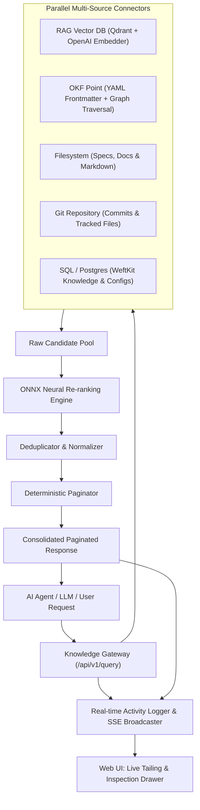

# Knowledge Gateway

> **Unified Enterprise AI Knowledge Gateway**  
> Consolidating heterogeneous knowledge sources (RAG, Open Knowledge Format, Filesystem, Git, and PostgreSQL) through local ONNX neural re-ranking, deterministic query pagination, and real-time request tailing.

---

## 1. Why Knowledge Gateway?

As of today, most AI systems fetch context exclusively from **RAG (Retrieval-Augmented Generation)** via vector similarity search. While vector search is effective for fuzzy semantic lookups, enterprise intelligence is distributed across fundamentally different mediums:
1. **Deterministic Graph Relations & Policies**: Open Knowledge Format (OKF) documents specifying explicit dependencies (`depends_on`, `governed_by`).
2. **Dense Vector Indexes**: Qdrant / PgVector embeddings for semantic recall.
3. **Relational Data**: PostgreSQL tables containing structured knowledge records and configuration parameters.
4. **Source Code & Version Control**: Git commit histories, branch trees, and tracked file versions.
5. **Local Filesystem & Specifications**: Architecture guides, runbooks, and Markdown documentation.

The **Knowledge Gateway** acts as a unified mediator between AI agents / LLMs and all these underlying knowledge points, mirroring how an API gateway routes HTTP microservices or how an MCP gateway mediates tool invocations.



---

## 2. Core Features

- **Multi-Source Fan-Out**: Dispatches asynchronous searches across all active connectors in parallel with per-source latency bounds.
- **Local ONNX Neural Re-ranking**: Evaluates candidate documents using a compiled ONNX neural model (`models/reranker.onnx`). Computes 8-factor feature vectors (semantic similarity, lexical overlap, title match, tag match, recency, source confidence, length prior, exact phrase match) to generate normalized confidence scores.
- **Deterministic Pagination**: Slices consolidated candidates into pages (`page`, `page_size`, `total_pages`, `has_next`, `has_previous`). Sending the same query with incremented page numbers yields non-overlapping subsequent items.
- **Configurable OpenAI-Compatible Embedding Endpoint**: Connects to OpenAI, OpenRouter, or local embedding servers via `config.yaml` (`openai_url`, `model_id`, `api_key`, `dimension`).
- **Live Tailing & Activity Stream**: Real-time Server-Sent Events (SSE) feed displaying incoming queries, latency, and status without page refreshing.
- **Deep Inspection Drawer**: Click any activity entry to inspect the exact places data was retrieved from (per-source item counts, latency, and traversal paths) and the raw ONNX feature score matrix.
- **Zero-Friction Docker Harness**: `test.sh` spins up Docker PostgreSQL (`weftkit_db`) and Qdrant containers automatically.

---

## 3. Supported Knowledge Connectors

| Connector | Source Type | Description | Key Provenance Metadata |
| :--- | :--- | :--- | :--- |
| **RAG Vector DB** | `rag` | Dense vector Approximate Nearest Neighbor search via Qdrant | `collection`, `point_id`, `dimension`, `embedding_model` |
| **OKF Point** | `okf` | Open Knowledge Format Markdown with YAML frontmatter & graph traversal | `file_path`, `version`, `verified_by`, `traversal_path` |
| **Filesystem** | `filesystem` | Recursive file scanner with context line snippet extraction | `file_path`, `line_number`, `file_size_bytes` |
| **Git Repository** | `git` | Commit history and tracked repository tree inspection | `commit_hash`, `author`, `branch`, `commit_date` |
| **PostgreSQL (SQL)** | `sql` | Relational tables (`weftkit_knowledge`, `weftkit_configs`) | `database`, `table`, `row_id`, `host` |

---

## 4. Quickstart

### Prerequisites
- Python 3.10+ (Recommended: Python 3.13)
- Docker Desktop (Optional for PostgreSQL & Qdrant containers; in-memory fallback included)

### 1. Run Automated Test Suite & Docker Harness
`test.sh` spins up Docker PostgreSQL (`weftkit_db`), runs database migrations and seed scripts, validates the ONNX model, executes 15 automated pytest integration suites, and outputs a live multi-source retrieval demo:

```bash
./test.sh
```

### 2. Launch Gateway Server & Web UI
`run.sh` bootstraps the environment and starts the gateway:

```bash
./run.sh
```

Once started, access:
- **Interactive UI Dashboard & Live Tailing**: [http://localhost:8080](http://localhost:8080)
- **Interactive OpenAPI Documentation (Swagger)**: [http://localhost:8080/docs](http://localhost:8080/docs)
- **Health Check**: [http://localhost:8080/health](http://localhost:8080/health)

---

## 5. Configuration (`config.yaml`)

```yaml
gateway:
  name: "Knowledge Gateway"
  version: "1.0.0"
  host: "0.0.0.0"
  port: 8080
  pagination:
    default_page_size: 5
    max_page_size: 50
  onnx_engine:
    enabled: true
    model_path: "models/reranker.onnx"
    score_threshold: 0.15

rag:
  enabled: true
  provider: "qdrant"
  host: "localhost"
  port: 6333
  collection: "weftkit_knowledge_rag"
  top_k: 8
  embedding:
    openai_url: "https://openrouter.ai/api/v1"
    model_id: "openai/text-embedding-3-small"
    api_key: "${OPENROUTER_API_KEY}"
    dimension: 768

okf:
  enabled: true
  root_dir: "data/okf"
  deterministic_traversal: true

filesystem:
  enabled: true
  directories:
    - path: "data/docs"
      patterns: ["*.md", "*.txt"]
    - path: "data/specs"
      patterns: ["*.md", "*.yaml"]

git:
  enabled: true
  repositories:
    - name: "knowledge-gateway"
      path: "."
      branch: "main"

sql:
  enabled: true
  provider: "postgresql"
  host: "localhost"
  port: 5433
  database: "weftkit_db"
  username: "weftkit_admin"
  password: "weftkit_secret"
  tables:
    - table_name: "weftkit_knowledge"
      search_columns: ["title", "content", "category", "tags"]
    - table_name: "weftkit_configs"
      search_columns: ["config_key", "config_value", "description"]
```

---

## 6. API Reference

### `POST /api/v1/query`
Executes multi-source parallel retrieval with ONNX re-ranking and deterministic pagination.

#### Request Body
```json
{
  "query": "Which services depend on vault secrets engine?",
  "tags": ["vault", "security"],
  "sources": ["rag", "okf", "filesystem", "git", "sql"],
  "page": 1,
  "page_size": 3,
  "min_score": 0.15
}
```

#### Response Payload
```json
{
  "query": "Which services depend on vault secrets engine?",
  "tags": ["vault", "security"],
  "page": 1,
  "page_size": 3,
  "total_results": 15,
  "total_pages": 5,
  "has_next": true,
  "has_previous": false,
  "latency_ms": 71.4,
  "sources_searched": {
    "rag": {"source_type": "rag", "count": 5, "latency_ms": 10.8, "status": "ok"},
    "okf": {"source_type": "okf", "count": 5, "latency_ms": 0.1, "status": "ok"},
    "filesystem": {"source_type": "filesystem", "count": 3, "latency_ms": 1.7, "status": "ok"},
    "git": {"source_type": "git", "count": 0, "latency_ms": 44.7, "status": "empty"},
    "sql": {"source_type": "sql", "count": 2, "latency_ms": 11.3, "status": "ok"}
  },
  "items": [
    {
      "id": "vault-secrets-engine",
      "source_type": "okf",
      "title": "HashiCorp Vault Secrets Engine",
      "score": 0.9995,
      "onnx_score": 0.9995,
      "snippet": "Manages all static and dynamic cryptographic secrets across the infrastructure...",
      "provenance": {
        "connector": "okf_knowledge_point",
        "file_path": "data/okf/services/vault-secrets-engine.md",
        "version": "1.15.2",
        "status": "active",
        "verified_by": "security-platform@weftkit.internal",
        "traversal_path": ["Entity: vault-secrets-engine"]
      },
      "metadata": {
        "doc_type": "service",
        "tags": ["vault", "secrets", "encryption", "kms"]
      }
    }
  ]
}
```

### `GET /api/v1/activity`
Returns the recent audit activity log with latency stats, source counts, and client metadata.

### `GET /api/v1/activity/{request_id}`
Returns deep inspection metadata for a single request, including raw feature vectors evaluated by the ONNX model and per-source retrieval origins.

### `GET /api/v1/tail/stream`
Server-Sent Events (SSE) stream emitting real-time events as queries are processed.

### `GET /api/v1/sources/status`
Returns the live connection health and document counts across all attached connectors and the local ONNX engine.

---

## 7. Web UI Walkthrough

1. **Live Tailing & Activity Stream**: Real-time incoming request feed displaying execution latency, status codes, top ONNX confidence scores, and source badges.
2. **Deep Inspection Modal**: Click any request row to view a breakdown of every source queried, how many items each source contributed, latency per connector, and the neural scoring matrix.
3. **Interactive Query Playground**: Submit natural language queries, attach/detach sources with one click, configure tags, and test multi-page pagination.
4. **Topology Dashboard**: Monitor health status for Qdrant Vector DB, PostgreSQL, OKF bundles, Filesystem, Git, and ONNX Runtime.

---

## 8. License

Apache 2.0 License.