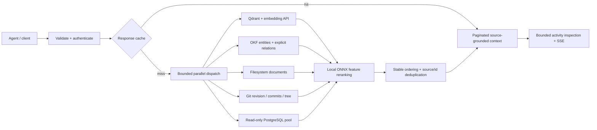

# Knowledge Gateway

An Apache-2.0 retrieval service that gives agents one API for knowledge spread across **Qdrant, OKF Markdown, files, Git, and PostgreSQL**. It returns ranked document context with provenance, source status, and pagination. Applications decide how to use that context; the gateway does not generate answers.

[CI](https://github.com/karthikrameshdev/knowledge-gateway/actions/workflows/ci.yml) · [API contract](docs/openapi.json) · [Architecture and deployment](docs/architecture.md) · [Contributing](CONTRIBUTING.md)

## Run an offline demonstration

Python 3.11+ is supported. No Docker, API key, embedding bill, or production database is needed for this mode.

```bash
./run.sh
# http://127.0.0.1:8080 — dashboard, playground and request inspection
# http://127.0.0.1:8080/docs — OpenAPI / Swagger
```

`run.sh` defaults to `config.demo.yaml`: synthetic documents in **explicit in-memory Qdrant**, deterministic test vectors, local sample OKF/files/Git, and an in-memory cache. SQL is disabled. There is no automatic fallback from a failed production embedding provider to synthetic vectors, and no production startup seeding.

For a configured installation, copy `config.example.yaml`, configure the enabled sources, and run:

```bash
KNOWLEDGE_GATEWAY_CONFIG=config.yaml KNOWLEDGE_GATEWAY_API_KEY="$MY_GATEWAY_KEY" ./run.sh
```

A nonempty `KNOWLEDGE_GATEWAY_API_KEY` protects **every `/api/` route**, including configuration, activity, SSE, and cache clearing. Send `X-API-Key` or `Authorization: Bearer`. The dashboard's **API key** button keeps the value only in page memory; authenticated SSE uses fetch, so tokens never enter stream URLs. Use TLS and a trusted identity-aware reverse proxy outside localhost. This release provides a shared service key, not user/tenant authorization.

## Retrieval pipeline



- Blocking file/Git/database/client work runs in bounded worker slots, keeping the async event loop available. Source deadlines include worker wait time. Timed-out synchronous work retains its slot until it actually finishes; network and SQL timeouts bound the underlying operations.
- Configurable query capacity and queue deadlines return `503` with `Retry-After` under overload. Identical in-flight queries share retrieval and return independent responses/request IDs.
- Failed/timed-out sources appear explicitly in `sources_searched`. Healthy sources still return results with `degraded: true`. Partial responses are not cached; all-source failure returns `503` instead of an empty successful answer.
- Cache keys use canonical JSON and SHA-256 with configuration scope and a namespace. Cached payloads are copied; one caller cannot mutate another's result. Set a distinct `cache.namespace` for independent datasets that share a Redis instance.
- Redis commands establish connectivity directly, without per-request PINGs. Failure backoff avoids repeated connection penalties. TTL, bounded memory LRU/LFU/FIFO fallback, and namespaced SCAN/UNLINK clearing are supported. Shared invalidation failures return `503`.
- Every query response has a request ID, also returned as `X-Request-ID`. Activity includes source timing, ranking features, provenance and cache status. SSE includes heartbeats and bounded subscriber buffers.

## Supported sources

| Type | Implemented behavior | Provenance |
|---|---|---|
| `rag` | One configured Qdrant collection per gateway instance; OpenAI-compatible embedding HTTP API; strict vector size/index/finite-value validation | Collection, point ID, model and dimension |
| `okf` | Bounded Markdown/YAML entity loading, generic explicit relationship traversal, reverse dependency/governance lookup, periodic refresh | File, version, status, verification metadata, traversal path |
| `filesystem` | Bounded lexical search in configured directories; skips hidden files, child symlinks and oversized files | File, matching line and size |
| `git` | Commit and tracked-tree lookup against configured repositories/revisions; subprocess argument arrays, no shell | Repository, branch/revision, commit and author |
| `sql` | PostgreSQL pooled read-only connections, statement/connect timeouts, parameterized values and quoted identifiers | Database, table, row ID |

Tags are ranking/retrieval hints, **not access-control filters**. Content deduplication is by `(source_type, id)`; cross-source semantic duplicate detection is not implemented. Pagination is stable for unchanged source snapshots and scores; it is not a durable snapshot cursor when data changes.

## Query API

```bash
curl http://127.0.0.1:8080/api/v1/query \
  -H 'Content-Type: application/json' \
  -H "X-API-Key: $KNOWLEDGE_GATEWAY_API_KEY" \
  -d '{"query":"Which services depend on vault-secrets-engine?","sources":["okf","filesystem"],"tags":["vault"],"page":1,"page_size":3,"min_score":0.15}'
```

Request limits: 64 KiB JSON body, 8,000-character nonblank query, up to 32 tags, five known source types, and pages of 1–50 items (also constrained by configured maximum). Unknown request/configuration fields fail validation. `null`/omitted sources selects enabled sources; an empty source list is invalid. An omitted page size uses the configured default.

| Route | Purpose |
|---|---|
| `POST /api/v1/query` | Retrieve context, provenance, per-source status and paging metadata |
| `GET /api/v1/sources/status` | Parallel bounded connector diagnostics |
| `GET /api/v1/config` | Configuration with full secret masking |
| `GET /api/v1/activity` | Filtered recent activity; `total` reflects the filter |
| `GET /api/v1/activity/{request_id}` | Query inspection / feature trace |
| `GET /api/v1/tail/stream` | SSE notifications and heartbeats |
| `GET /api/v1/cache/stats` | Local process cache metrics |
| `POST /api/v1/cache/clear` | Explicit invalidation; no success response if shared Redis clear fails |
| `GET /health` | Cheap process liveness |
| `GET /ready` | Retrieval readiness; at least one healthy enabled source required |

## Ranking: what the model actually does

The bundled ONNX graph is an **8 → 16 → 8 → 1 feature network with hand-authored weights**, exported by `models/export_onnx_model.py`. It is not a trained transformer cross-encoder and its scores are not calibrated factual confidence probabilities. Features are hashed-text similarity (blended with Qdrant similarity for RAG), lexical overlap, title/tag overlap, a fixed recency prior, source prior, length prior, and exact phrase overlap. Missing/disabled ONNX Runtime uses the documented heuristic path. Tie-breaking is by score, source type, then ID; input candidates are not mutated.

## Verification

```bash
./test.sh                       # Offline unit/API/regression suite
./test.sh --integration         # Isolated Docker PostgreSQL, Redis, Qdrant; stack removed on exit
postman simulation run postman/simulations/embedding-dependencies/embedding-dependencies.sim.yaml --port 4909 --no-history --output ndjson
# In a separate shell, while the simulation runs:
KG_SIMULATION_URL=http://127.0.0.1:4909 .venv/bin/python -m pytest -q -m simulation
.venv/bin/python scripts/benchmark.py http://127.0.0.1:8080
```

The committed simulation was built from the used subset of the public embedding API contract. It exercises actual HTTP calls through the real RAG connector for success, malformed vectors, JSON errors, HTML proxy failures, and timeout. It does not validate paid provider availability or semantic quality. See its [run context](postman/simulations/embedding-dependencies/embedding-dependencies.context.md).

The October 28, 2026 validation ran **53 passing tests** with real local PostgreSQL/Redis/Qdrant and the HTTP simulation. The small local HTTP benchmark (OKF + filesystem fixtures, Python 3.13) measured cold median **2.599 ms**, warm HTTP median **1.233 ms**, and warm service median **0.080 ms**; all 20 concurrent warm requests succeeded. These are local measurements, not deployment guarantees. Full scope and output: [validation](docs/validation.md).

## Deployment boundaries

Read [architecture.md](docs/architecture.md) before exposing the service. Production data access, tenant boundaries, source-specific credentials, TLS, durable audit storage, ingestion/change events, and deployment monitoring remain operator responsibilities. Source data can remain cached until TTL expiry or an explicit clear. This release has no automatic source-change watcher or webhook endpoint.

Install `requirements.lock` for the pinned dependency set. The non-root Dockerfile is available; mount your configuration and source directories and provide secrets through the environment. Restrict `security.allowed_hosts` and `security.cors_origins` to your deployment. Only PostgreSQL and Qdrant are implemented database providers.

## Contributing and license

Apache 2.0. Contributions follow [CONTRIBUTING.md](CONTRIBUTING.md) and the repository's protected-branch review requirements. Report vulnerabilities through [SECURITY.md](SECURITY.md).
